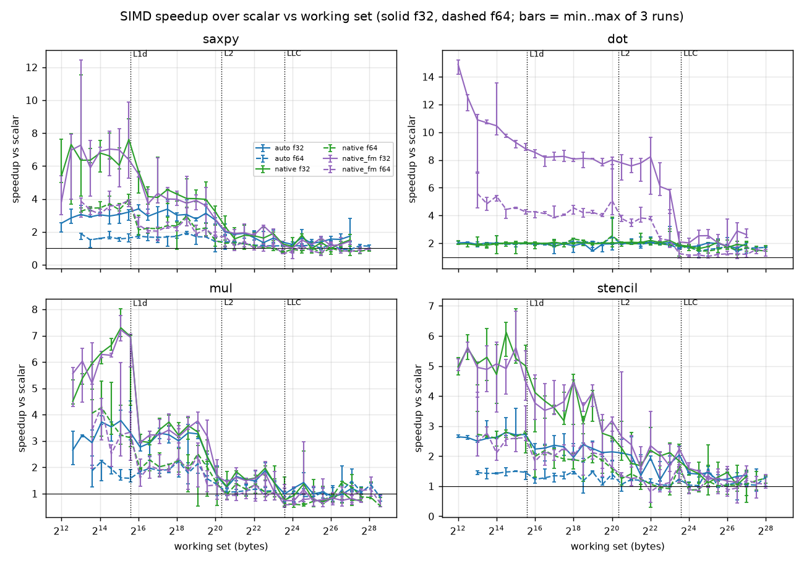
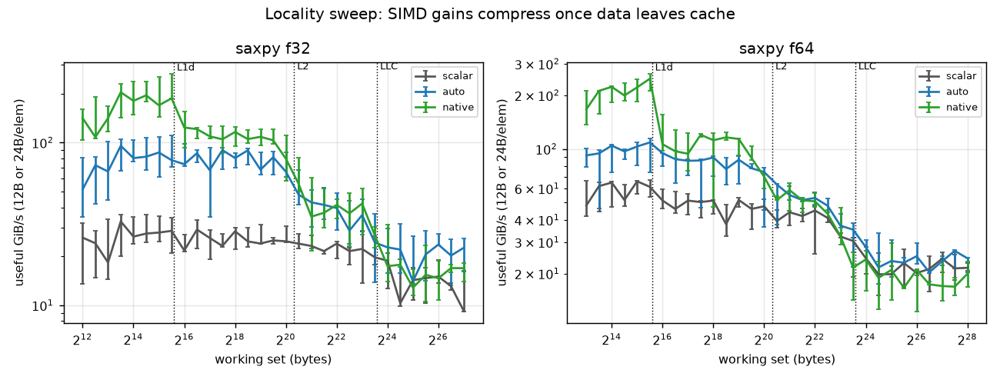
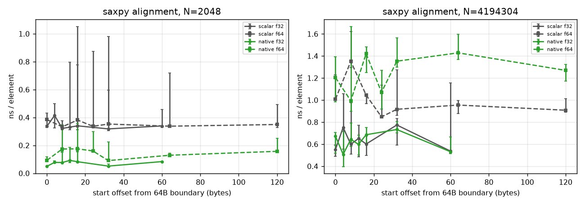
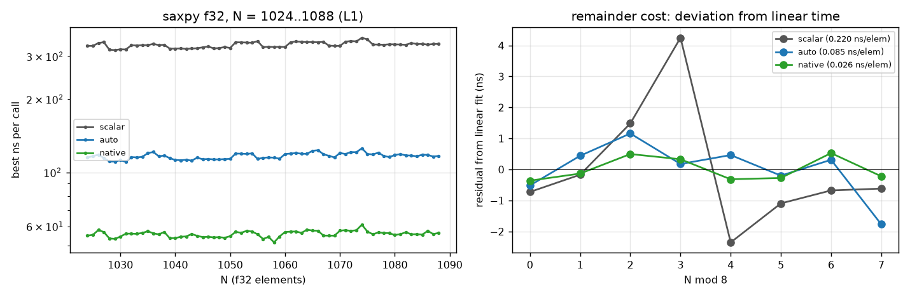
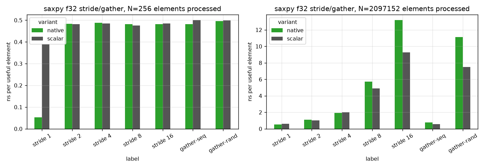
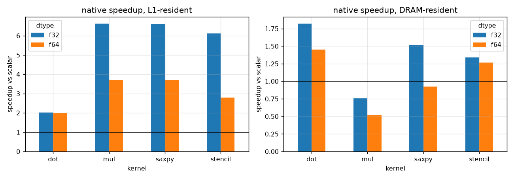
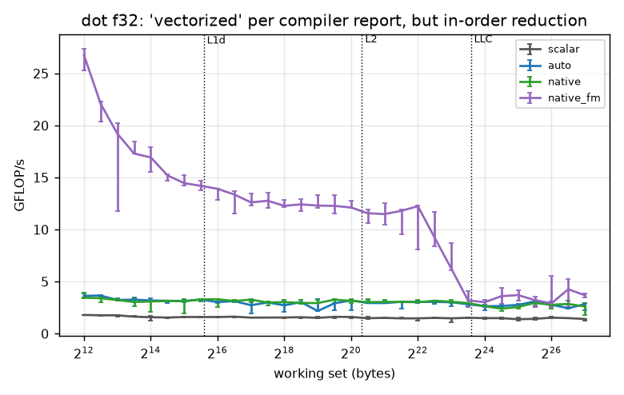
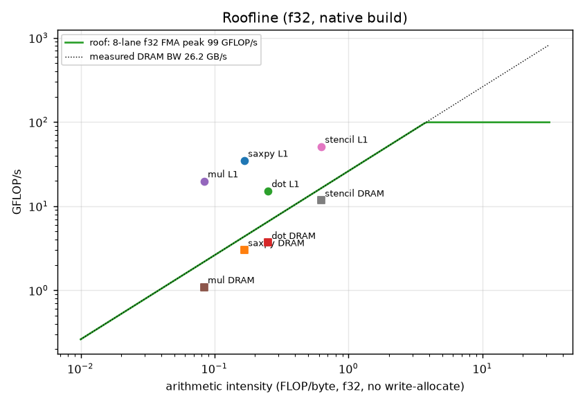

# Project 1 Report: SIMD Advantage Profiling

Haruto Suzuki, ECSE 4320/6320. All numbers come from `results/raw/*.csv` (3 full sweeps); tables are in `results/processed/summary.md`.

## 1. AI-use note

- **Tools.** Claude (Anthropic) generated the first version of the benchmark driver, kernels, Makefile variants, experiment, plotting and eses 1 and 2 are confir-summary scripts, and a report draft.
- **What I did and checked myself.** I ran every experiment on my laptop, picked the pinned CPU by timing all 12 logical CPUs, checked the correctness column (0 failures in 3,897 rows), read the `dot_f32` and `saxpy_stride_f32` disassembly to confirm what the compiler actually emitted, and checked every number quoted below against the CSVs.
- **Rejected or changed.**
  - The first kernel file used a C macro, so the compiler's vectorization report attributed all 12 loops to the same source line. That evidence was useless, so the kernels were rewritten as explicit functions.
  - GCC reports the f32 dot loop as "vectorized using 32 byte vectors." The disassembly shows a strict in-order reduction, so I did not accept the report as evidence (Section 8).
  - The first plots used ±std error bars, which went below zero for noisy points. I replaced them with min..max across the 3 runs, with speedup computed per run.
  - The first "L1" comparison used one N for all kernels, which put f64 `mul` (3 arrays, 69 KB) in L2. The L1 point is now chosen per kernel and dtype.
  - The 5.0 GHz turbo clock in `machine.json` was replaced by a clock estimated from my own data (Section 2).
  - The AVX-512 build was dropped because this CPU has no AVX-512.

## 2. Environment and methodology

| item            | value                                                                                                                                                                                                |
| --------------- | ---------------------------------------------------------------------------------------------------------------------------------------------------------------------------------------------------- |
| CPU             | Intel Core i7-1355U (Raptor Lake; 2 P-cores + 8 E-cores, 12 logical CPUs), AVX2 + FMA, no AVX-512                                                                                                    |
| caches (P-core) | L1d 48 KiB, L2 1.25 MiB per core; L3 12 MiB shared                                                                                                                                                   |
| memory          | 16 GB                                                                                                                                                                                                |
| OS              | Ubuntu 22.04.5 on WSL2, kernel 6.18.40.1-microsoft-standard-WSL2                                                                                                                                     |
| compiler        | GCC 11.4.0. Driver: `-O2 -fno-tree-vectorize`. Kernels: see table below                                                                                                                              |
| frequency       | Windows "Best performance" power mode, on AC power. Governor and turbo **cannot** be controlled from WSL2                                                                                            |
| SMT             | on                                                                                                                                                                                                   |
| pinning         | `taskset -c 4`                                                                                                                                                                                       |
| timing          | `clock_gettime(CLOCK_MONOTONIC)`; reps calibrated so each trial lasts at least 30 ms; 7 trials per config, median reported; whole sweep repeated 3 times; error bars = min..max of the 3 run medians |
| data            | uniform [-1, 1), fixed-seed xorshift; arrays 64 B aligned and first-touched before timing                                                                                                            |
| correctness     | each run checks one call against a double-precision scalar reference (rel. tol 1e-5 f32, 1e-4 f32 dot, 1e-12 f64): **0 failures**                                                                    |

| build     | flags                                                           | vector width                   |
| --------- | --------------------------------------------------------------- | ------------------------------ |
| scalar    | `-O3 -march=native -fno-tree-vectorize -fno-tree-slp-vectorize` | none (scalar FMA allowed)      |
| auto      | `-O3`                                                           | 128-bit SSE2, no FMA           |
| native    | `-O3 -march=native`                                             | 256-bit AVX2 + FMA             |
| native_fm | `-O3 -march=native -ffast-math`                                 | 256-bit, reassociation allowed |

**Clock estimate.** Because the clock isn't fixed, I estimate it from two latency-bound loops. The scalar dot product is a chain of dependent `vfmadd231ss` (4-cycle latency) and runs at 1.29 ns/element. The `native` dot is a chain of dependent `vaddss` and runs at 0.636 ns/element. Both are consistent with about **3.1 GHz** (4 cycles and 2 cycles respectively). The ratio of exactly 2.0 also tells me the run was on a P-core: Golden Cove has a low-latency FP adder, and an E-core would not give 2.0. I use 3.1 GHz for the roofline and report ns/element instead of cycles/element.

**Pinning caveat.** In WSL2, `taskset` pins to a virtual CPU, and the Windows scheduler decides which physical core runs it. All 12 vCPUs timed within about 16% of each other on an L1 SAXPY probe (0.049 to 0.057 ns/elem), so I could not target a specific P-core.

## 3. Pre-experiment hypotheses (written before running)

1. **L1-resident:** speedup approaches the lane count, minus overhead: about 8x for f32 and 4x for f64 with 256-bit vectors. The 128-bit `auto` build gets about half of `native`.
2. **Memory-bound:** past the LLC every build converges to DRAM bandwidth and speedup falls to about 1x. The stencil (highest AI) keeps its gains longest.
3. **Dot product:** without `-ffast-math`, the FP sum can't be reordered, so the loop is latency-bound and vector width shouldn't help. Only `native_fm` speeds it up.
4. **Alignment:** a measurable cost in L1 when 256-bit loads split cache lines; negligible in DRAM.
5. **Tail:** ns/call shows a sawtooth with period equal to the vector width.
6. **Stride:** cost grows with the fraction of each cache line wasted. Random gather is worst in DRAM.
7. **f32 vs f64:** f32 has 2x the lanes, so it gets about 2x the speedup when compute-bound.
8. **AVX-512:** n/a on this CPU.

## 4. Vectorization verification

`reports/vec_summary.md` counts the instructions in each kernel's disassembly and lists the compiler messages. Key evidence:

- **scalar:** no "loop vectorized" messages. `saxpy_f32` is one `vfmadd231ss` per element.
- **auto:** "loop vectorized using 16 byte vectors" for all 12 loops. `xmm` registers only, `mulps`/`addps`, no FMA (the baseline x86-64 ISA has no FMA).
- **native:** "32 byte vectors". `saxpy_f32` uses `vfmadd231ps ymm`.
- **saxpy_stride_f32 (native):** the loop is _versioned_. The compiler reports both "couldn't vectorize loop / Loop costings may not be worthwhile" and "vectorized using 32 byte vectors". The vector path runs only when stride == 1; any other stride runs the scalar fallback (Section 7).
- **saxpy_gather_f32:** the gather column is 0 for every build. GCC never emits `vgatherdps`; it loads the 8 indexed values with scalar loads and inserts them into a vector.
- **dot_f32 (native):** reported "vectorized", but the inner loop is `vmulps ymm` followed by **8 serial `vaddss`** into one accumulator (Section 8).

## 5. Baseline and locality (Fig. 1, Fig. 2)

Speedup over scalar for `native`, with the largest L1-resident N vs. DRAM (N = 16M):

| kernel          | f32 L1 | f32 DRAM | f64 L1 | f64 DRAM |
| --------------- | ------ | -------- | ------ | -------- |
| saxpy           | 6.6x   | 1.5x     | 3.7x   | 0.93x    |
| mul             | 6.6x   | 0.76x    | 3.7x   | 0.52x    |
| stencil         | 6.1x   | 1.3x     | 2.8x   | 1.3x     |
| dot (fast-math) | 9.7x   | 2.6x     | 4.4x   | 1.4x     |

The SIMD gain compresses in steps that line up with the cache boundaries. Take f32 SAXPY as the example:

- In L1 (up to 48 KiB), `native` moves about 190 GiB/s, which is about 0.057 ns/element, or roughly 5.6 elements/cycle at 3.1 GHz.
- In L2 it drops to about 100 GiB/s, which is 4x scalar.
- Past L2 (1.25 MiB) it falls to 35 to 40 GiB/s, about 2x scalar.
- Past the 12 MiB LLC it sits at 15 to 20 GiB/s, the same as scalar within run-to-run spread.

Scalar SAXPY is roughly flat at about 25 GiB/s through L1, L2 and L3. That's because scalar is limited by about 1 element/cycle (2 loads and 1 store per element), not by the caches. Once the vector code becomes bandwidth-bound, its lead shrinks to whatever bandwidth headroom the scalar loop left unused.

The 128-bit `auto` build is about half of `native` in L1 (3.0x vs 6.6x for f32 SAXPY), matching the 4-vs-8 lane ratio.    Hypothesis 1 is largely confirmed (about 80% of the lane count) and hypothesis 2 is confirmed.

## 6. Alignment and tail (Fig. 3, Fig. 4)

**Alignment (L1, N = 2048, native).**

- **f32:** aligned runs at 0.050 ns/elem. Offsets of 4, 8, 12 and 16 B run at 0.077 to 0.092 ns/elem, 55 to 85% slower. A 32 B offset runs at 0.051, which is back to full speed.
- **f64:** aligned is 0.093. Offsets of 8 to 24 B run at 0.16 to 0.17, about 75 to 90% slower. A 32 B offset runs at 0.091, also full speed.

The pattern is the mechanism: a 32-byte `ymm` load splits across two cache lines unless the start is a multiple of 32 B, and a split load costs two L1 accesses.

The scalar build is flat at about 0.33 to 0.38 ns/elem, since 4- and 8-byte loads never split. In DRAM (N = 4M), the misalignment effect disappears into run-to-run noise (0.51 to 0.73 ns/elem for f32 with no trend), because each cache line is fetched from DRAM once whether or not the loads split it. Hypothesis 4 is confirmed.

**Tail (N = 1024..1088).** The best time per call is linear in N: 0.026 ns/elem for native, 0.085 for auto, 0.220 for scalar. After removing the linear fit, the residual grouped by N mod 8 varies by only 0.9 ns for native (about 1.5% of a 58 ns call). There is no visible sawtooth.

GCC 11's remainder handling (a 128-bit vector epilogue, then at most 3 scalar iterations) costs at most a few scalar iterations of about 0.2 ns each, which is below the noise floor at this N. Hypothesis 5 is not confirmed at this size. The remainder only matters when N is small enough that a few extra iterations are a large fraction of the call.

## 7. Stride/gather (Fig. 5) and data type (Fig. 6)

**Stride in L1 (N = 256 elements processed).** Stride 1 runs at 0.053 ns/elem. Strides 2 through 16 all run at 0.48 ns/elem, a **9x cliff at stride 2**. Scalar runs at the same 0.48 at every stride above 1.

The cause is code generation, not memory: Section 4 shows the loop is versioned so that only the stride-1 path is vectorized. Any non-unit stride falls back to scalar code, and this happens even when all the data is in L1.

**Stride in DRAM (N = 2M, f32, native).** Time per element is 0.53, 1.11, 1.92, 5.74 and 13.2 ns for strides 1, 2, 4, 8 and 16. Useful bandwidth falls from 21 to 0.85 GiB/s.

- Up to stride 4, cost tracks cache lines touched per element (1/16, 1/8, 1/4), so time is set by line traffic.
- At stride 8 and 16 the cost per line also rises, from about 8.5 to about 13 ns/line. At stride 16 every access is a new line and every 64 elements is a new 4 KiB page, so TLB misses and fewer prefetchable lines add cost.
- f64 hits one line per element at stride 8 (13.6 ns/elem) and behaves the same way.

**Gather.**

- In L1, `gather-seq` and `gather-rand` cost the same as scalar (0.48 to 0.50 ns/elem). The emulated gather has no SIMD advantage.
- In DRAM, the random index pattern costs 11.1 ns/elem vs 0.76 for sequential indices, 15x slower. Every element is a cache miss with no spatial locality.
- Native random gather (11.1) was slower than scalar (7.5) for f32, but faster for f64 (12.1 vs 13.7). Both sit inside the large DRAM-regime spread, so I don't draw a conclusion from that difference.

**Data type.** In L1, f32 speedups are 6.1 to 6.6x and f64 speedups are 2.8 to 3.7x. That is about 80% of the 8 and 4 lane counts, with the remainder going to loop overhead and the 2-loads-per-cycle limit. In elements/ns, f32 SAXPY is 2.0x faster than f64 in L1 (0.057 vs 0.112 ns/elem) and about 1.7x faster in DRAM (0.66 vs 1.12), because f32 moves half the bytes per element. Hypothesis 7 is confirmed in L1.

## 8. Negative case: the dot product that "vectorized" but didn't use SIMD (Fig. 8)

GCC's `-fopt-info-vec` says the f32 dot loop was vectorized with 32-byte vectors. A reader trusting that report, or an AI-generated benchmark that only checks it, would expect about 8x. The real numbers:

| build                             | inner loop                                          | L1 ns/elem | speedup |
| --------------------------------- | --------------------------------------------------- | ---------- | ------- |
| scalar                            | dependent `vfmadd231ss` chain                       | 1.29       | 1.0x    |
| native (report says "vectorized") | `vmulps ymm`, then 8 serial `vaddss`                | 0.636      | 2.0x    |
| native_fm                         | `vaddps`/`vfmadd` with multiple vector accumulators | 0.132      | 9.7x    |

IEEE semantics forbid reordering the sum. So the "vectorized" loop multiplies 8 lanes at once and then adds them into one scalar accumulator in order. Throughput is set by FP-add latency, not vector width.

Its 2.0x win over scalar is not a SIMD effect. It comes from moving the multiply off the loop-carried dependency chain, which shortens the chain from a 4-cycle FMA to a 2-cycle add (1.29 ns vs 0.636 ns, both at about 3.1 GHz). Only `-ffast-math`, which allows reassociation into several independent vector partial sums, gives the real SIMD speedup. It also changes the result slightly, which the `max_err` column shows.

A second consequence: the scalar dot product never becomes memory-bound. It runs at 1.42 ns/elem in DRAM for both f32 and f64, identical, because the latency chain is slower than DRAM.

Lesson: a "loop vectorized" message is not evidence of a speedup. The instruction mix and the timing are.

## 9. Roofline (Fig. 7)

- **Arithmetic intensity** (f32, useful bytes, no write-allocate): SAXPY 2/12 = 0.167, dot 2/8 = 0.25, mul 1/12 = 0.083, stencil 5/8 = 0.625 FLOP/B.
- **Bandwidth roof:** the best sustained useful DRAM bandwidth from any build is **26.2 GB/s**.
- **Compute roof:** peak f32 compute = 3.1 GHz x 2 FMA units x 8 lanes x 2 FLOP = **99 GFLOP/s**.
- **Ridge point:** 99 / 26.2 = **3.8 FLOP/B**. Every kernel here has AI at least 6x below the ridge, so all of them are **memory-bound** once they leave cache, no matter how wide the vectors are. That is why SIMD speedup collapses toward 1x past the LLC.

DRAM-resident points reach 50 to 72% of the bandwidth roof (`results/processed/roofline.csv`): stencil 72%, SAXPY 69%, dot 56%, mul 50%.

Two caveats on these percentages:

- `mul` writes `z` without reading it, so write-allocate adds a 4 B read per element. Real traffic is 16 B/elem, not 12, which puts mul at about 67% of the roof. SAXPY has no such hidden traffic because it reads `y` before writing it.
- The bandwidth number itself is single-core. One core can't saturate the memory controller, so the roof is a single-thread ceiling, not the DRAM spec.

L1-resident points sit 2.3x to 9x _above_ the DRAM roof. They are limited by L1 load/store bandwidth, not DRAM, and they still reach only 15 to 51% of the 99 GFLOP/s compute peak, because at under 1 FLOP/B even L1 bandwidth binds before the FMA units do.

## 10. Anomalies and limitations

**`mul` is slower with SIMD in DRAM.** Native `mul` at N = 16M is 0.52x scalar for f64 and 0.76x for f32. It was consistent in all 3 runs: native took 1.91 to 1.96 ns/elem against 0.96 to 1.66 for scalar. Hypotheses:

- **(H1) 4K aliasing.** x, y and z are separate 128 MB allocations whose addresses share the same low 12 bits, so each store to `z[i]` looks like it may conflict with loads of `x[i]` and `y[i]`. The vector loop keeps more loads in flight, so it hits more of these false dependencies.
- **(H2) Run order and power limits.** `native` runs after `scalar` in every sweep, and a 15 W U-series chip may lower its clock under sustained load. SAXPY f64 doesn't show the same drop, which argues against H2.

`scripts/anomaly_mul.sh` tests both: it alternates the two builds over 5 rounds and shifts `z` by 2,112 B to break the aliasing. Results, f64 ns/elem over 5 rounds:

| z shift | native median (min..max) | scalar median (min..max) |
| ------- | ------------------------ | ------------------------ |
| 0 B     | 1.85 (1.43..2.00)        | 1.16 (1.02..1.31)        |
| 2,112 B | 1.50 (1.32..1.99)        | 1.14 (1.02..1.28)        |

- **H2 is rejected.** With the builds interleaved, native is still slower than scalar in every pairing, so run order and heat are not the cause.
- **H1 is partly supported.** Breaking the aliasing cut native's median by 19% and left scalar unchanged. But the ranges overlap, and native is still 1.3x slower than scalar afterward, so aliasing explains at most part of the gap.
- **The rest is unexplained.** One untested idea (H3): the vector loop issues stores to fresh `z` lines faster, so read-for-ownership traffic competes with the `x`/`y` stream prefetchers. Testing it needs memory-traffic counters, and `perf` is not available in WSL2.

**Scalar f32 SAXPY in DRAM is slow.** It runs at 9.2 GiB/s, against 21.6 GiB/s for f64. That makes f32 SAXPY show a 1.5x "DRAM speedup" that f64 doesn't. A plausible cause is limited memory-level parallelism: in the scalar f32 loop, the out-of-order window covers fewer cache lines ahead per stream than in the f64 or vector loops, and by Little's law fewer lines in flight means less bandwidth. `mul` f32 scalar (17 GiB/s) doesn't fit that pattern perfectly, so this stays a hypothesis.

**Noise.** Run-to-run spread is ±20 to 40% in the L2 to DRAM range (Fig. 1 error bars) and in some L1 alignment points. Likely causes are Windows background activity, the hypervisor moving the vCPU between physical cores, and a laptop with an unfixed clock. Medians of 3 x 7 trials are reported, and claims are only made where the effect is larger than the min..max spread.

**Limitations.**

- WSL2 prevents fixing the frequency, disabling turbo or SMT, or isolating a core, and `perf` is not available in WSL2, so there are no hardware counter results. The 3.1 GHz clock is an estimate.
- There is a single machine and a single compiler (GCC 11). Clang may vectorize the stride and gather loops differently.
- Useful-byte accounting ignores write-allocate traffic.
- The alignment and tail studies use SAXPY only.
