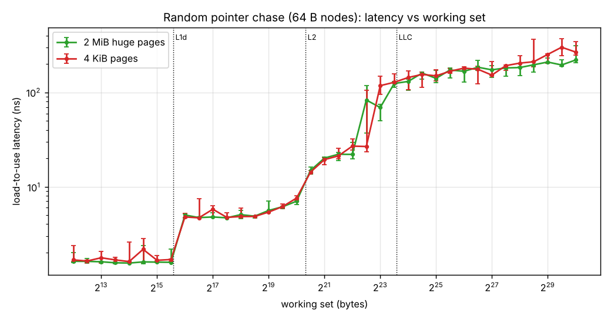
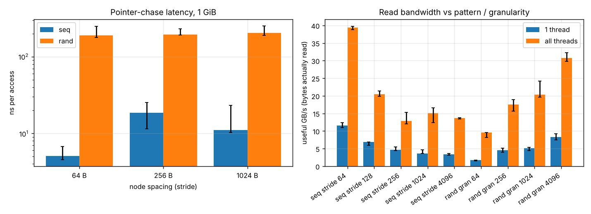
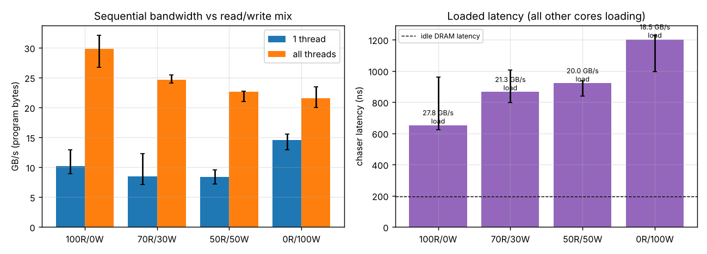
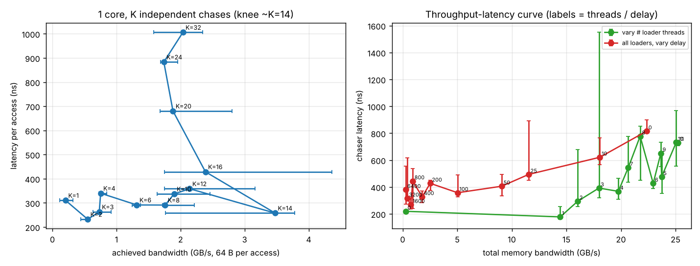
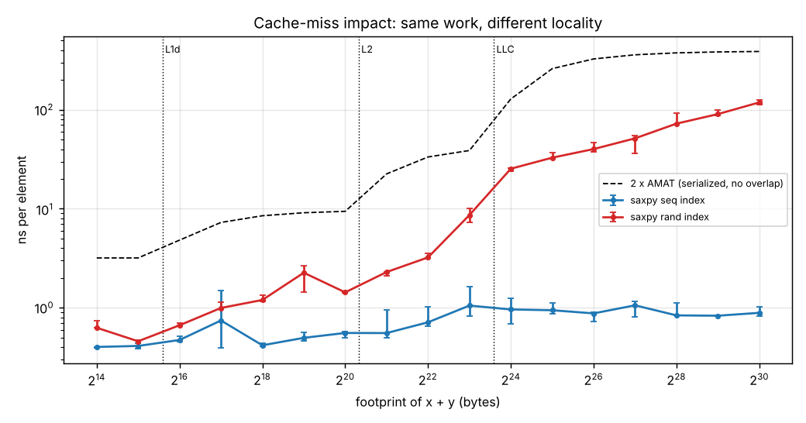
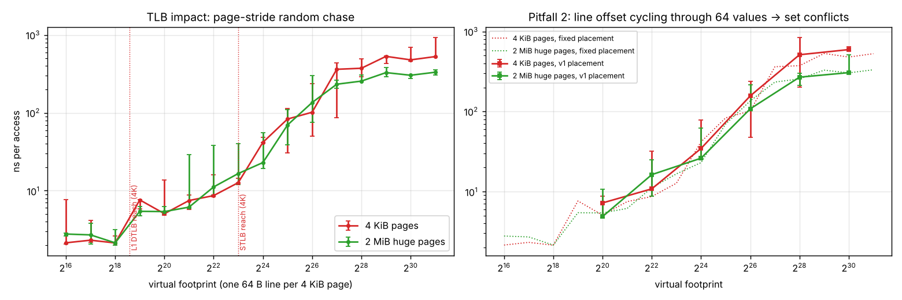
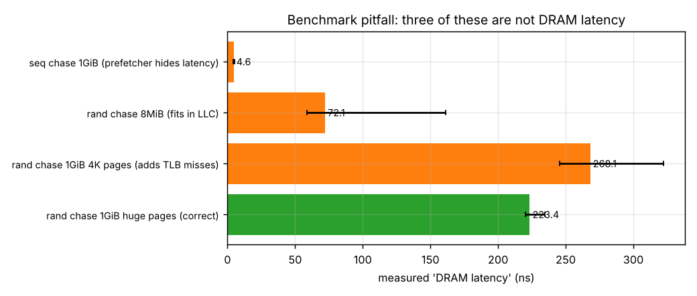

# Project 2 Report: Cache & Memory Performance Profiling

Haruto Suzuki, ECSE 4320/6320. All numbers come from `results/raw/*.csv` (3 repeats per experiment). Tables are in `results/processed/summary.md`. Error bars are min..max across the 3 repeats.

## 1. AI-use note

- **Tools.** Claude (Anthropic) generated the first version of the measurement tool (`src/mem.c`, `src/chains.h`), the experiment and plotting scripts, and a report draft.
- **What I did and checked myself.** I ran all experiments on my laptop and picked the pinned CPU by timing a 4 MiB chase on six vCPUs. I threw away a first full run after seeing 5x disagreement between repeats, then reran with background apps closed. I checked the quoted numbers against the CSVs.
- **Rejected or changed.**
  - **The first full run was discarded.** The same 2 MiB latency point measured 111, 155 and 23 ns across repeats, and the K-chain sweep was non-monotonic. Background load on Windows was disturbing it. I closed apps, paused OneDrive, chose the steadiest vCPU, and reran.
  - **The TLB test was rewritten** after it showed huge pages *slower* than 4 KiB pages at 4 to 64 MiB. The first version placed one line per page at offset `(i * 2654435761) % 64`, which only cycles through 64 values. With physically contiguous pages, that maps every node into a small subset of cache sets. The fixed version uses a full 64-bit hash, and the old one is kept as a demo (Section 10).
  - **The knee rule was replaced.** The first rule ("throughput gain < 10%") picked a noise dip. It was changed to the K with the highest throughput.
  - **The AMAT comparison was corrected.** It originally counted one random line per element, but `y[j] = a*x[j] + y[j]` touches two (`x[j]` and `y[j]`).
- **Not done.** No hardware performance counters: WSL2 doesn't expose the PMU, and `perf_event_open` returns ENOENT. The tool tries, and records `NA`.

## 2. Environment and methodology

| item | value |
|---|---|
| CPU | Intel Core i7-1355U (Raptor Lake; 2 P-cores with SMT + 8 E-cores = 12 vCPUs) |
| caches (P-core) | L1d 48 KiB, L2 1.25 MiB per core; L3 12 MiB shared |
| memory | 32 GB DDR5-5200 (2 x 16 GB SO-DIMM rated 5600, configured 5200), dual-channel; WSL2 VM sees 15 GiB |
| OS | Ubuntu 22.04.5 on WSL2 (kernel 6.18.40.1-microsoft-standard-WSL2), single NUMA node |
| compiler | GCC 11.4, `-O3 -march=native -pthread` |
| frequency | Windows "Best performance", on AC power; governor and turbo not controllable from WSL2. Clock about 3.1 GHz: L1 load-to-use measured 1.59 ns = 5 cycles at 3.14 GHz, matching the Project 1 estimate |
| SMT | on |
| pinning | latency thread pinned to vCPU 4; loaders on vCPUs 0-3 and 5-11 (`sched_setaffinity`) |
| pages | THP mode `madvise`; each buffer explicitly `MADV_HUGEPAGE` or `MADV_NOHUGEPAGE`; huge fraction checked per run from `/proc/self/smaps_rollup` (1.00 and 0.00 as intended in every run) |
| timing | `clock_gettime(CLOCK_MONOTONIC)`; chase steps calibrated to at least 200 ms per point; bandwidth points 400 ms; loaded points 800 ms |

**Latency method.** The latency test is a random cyclic permutation (Sattolo) of 64 B nodes. Each node stores the address of the next, so every load depends on the one before it and no prefetcher can guess the next address. One full warm-up traversal (capped at 4M steps) runs before timing.

**Bandwidth method.** Each thread is pinned and owns a slice of a 2 GiB buffer. `read_pct` sets what fraction of 64 B accesses are reads, with the rest being full-line writes. Bandwidth is reported as bytes the program touched.

## 3. Pre-experiment hypotheses (written before running)

1. L1 about 5 cycles, L2 about 15, L3 50 to 70; DRAM 90 to 120 ns with huge pages, and noticeably more with 4 KiB pages because of page walks.
2. Sequential access approaches peak bandwidth thanks to prefetchers. Random 64 B access is several times lower; larger random granules recover most of the gap.
3. All-write is slowest because of read-for-ownership (RFO) plus writeback, so DRAM moves 2x the bytes written. Loaded latency is highest with writes in the mix.
4. Throughput grows with outstanding requests until per-core miss buffers (about 16 L1 fill buffers) or the controller saturate. After that knee, latency rises with no throughput gain. Little's law should match.
5. Latency steps at about 48 KiB, 1.25 MiB and 12 MiB.
6. With one access per 4 KiB page, latency jumps past the L1 DTLB (about 96 pages) and the STLB (about 2048 pages, 8 MiB). Huge pages remove most of the penalty.
7. A sequential chase, or a buffer that fits in the LLC, will report a far too low "DRAM latency".

## 4. Zero-queue baselines (Fig. 1)

| level | working sets used | latency | cycles @ 3.1 GHz |
|---|---|---|---|
| L1d | 4 to 23 KiB | 1.59 ns | 4.9 |
| L2 | 128 to 512 KiB | 4.86 ns | 15.1 |
| L3 (LLC) | 2.8 to 5.7 MiB | 22.1 ns | 68.5 |
| DRAM, 2 MiB pages | 128 MiB to 1 GiB | 196 ns | 608 |
| DRAM, 4 KiB pages | 1 GiB | 269 ns | 835 |

L1, L2 and L3 match hypothesis 1 and stay within about ±10% across repeats.

DRAM is much slower than the 90 to 120 ns I expected. I think the main reason is WSL2: it is a Hyper-V virtual machine, so every TLB miss needs a two-dimensional page walk through both the guest page tables and the hypervisor's (EPT). Section 9 backs this up. Laptop power management of the memory controller and DRAM also likely adds latency.

Between page sizes, the 4 KiB vs 2 MiB difference is 73 ns at 1 GiB. That gap is the extra page-walk cost per access.

Caveat: each plateau is a median over a size range chosen inside each level. Measured points near the boundaries mix two levels.

## 5. Pattern and granularity sweep (Fig. 2)

**Latency (1 GiB, huge pages).**
- A random chase costs 191 to 203 ns whatever the node spacing (64, 256 or 1024 B), because every access is a DRAM miss.
- A sequential chase costs **5.0 ns** at 64 B spacing. The prefetcher streams the next lines in ahead of time, so the chase never waits on DRAM.
- At 256 B spacing it costs 18.6 ns and at 1024 B 11.0 ns. The prefetcher still detects these strides but covers less of the latency per line. 256 B coming out slower than 1024 B is within this experiment's run-to-run spread (11 to 25 ns).

**Bandwidth (GB/s of bytes the program read).**

| pattern | 1 thread | all 12 threads |
|---|---|---|
| seq, stride 64 B (dense) | 11.6 | **39.4** |
| seq, stride 128 B | 6.8 | 20.5 |
| seq, stride 256 B | 4.7 | 12.8 |
| seq, stride 1024 B | 3.6 | 15.1 |
| seq, stride 4096 B | 3.3 | 13.6 |
| random, 64 B granules | 1.7 | 9.6 |
| random, 256 B | 4.6 | 17.5 |
| random, 1024 B | 5.1 | 20.4 |
| random, 4096 B | 8.3 | 30.8 |

- **Strided access wastes bandwidth.** Useful bandwidth halves at stride 128 B. That's consistent with the spatial prefetcher still fetching adjacent 128 B line pairs, so half of each fetch is wasted. Beyond 256 B it flattens at about 13 to 15 GB/s, where every access costs a full line miss.
- **Granularity recovers random bandwidth.** Random 64 B granules get 9.6 GB/s (24% of sequential). 4 KiB granules get 30.8 GB/s (78%), because the prefetcher can stream within each 4 KiB block. Hypothesis 2 is confirmed.
- **One core can't saturate memory.** It reaches 11.6 GB/s (29% of the all-core peak), limited by how many misses it can keep in flight (Section 7).

Theoretical peak: dual-channel DDR5-5200 = 2 channels x 8 B x 5.2 GT/s = **83.2 GB/s**. The best measured all-core read, 39.4 GB/s, is **47%** of that, and the 30 GB/s seen in the mix sweep is 36%. On bare-metal desktops 70 to 85% is typical. The gap here fits the other findings: the 15 W chip's power limit caps how many misses all cores can sustain (Section 10), and every miss pays the Hyper-V page-walk overhead (Section 9).

## 6. Read/write mix (Fig. 3)

| mix | 1 thread GB/s | all threads GB/s | loaded latency (others streaming) |
|---|---|---|---|
| 100% read | 10.2 | 29.8 | 652 ns at 27.8 GB/s |
| 70R / 30W | 8.5 | 24.6 | 865 ns at 21.3 GB/s |
| 50R / 50W | 8.3 | 22.6 | 921 ns at 20.0 GB/s |
| 100% write | 14.5 | 21.5 | 1202 ns at 18.5 GB/s |

With all cores, program bandwidth drops steadily as writes increase, and loaded latency rises from 652 to 1202 ns, which confirms hypothesis 3. Every write miss first reads the line in (RFO) and later writes it back. So 21.5 GB/s of program writes is about 43 GB/s of DRAM traffic, which is roughly the read-only peak. The DRAM bus also loses time switching between reads and writes, which hurts the mixed cases.

Surprise: **one thread writes faster than it reads** (14.5 vs 10.2 GB/s). Stores retire into the store buffer and their RFOs are issued without stalling the core, so a single thread keeps more write misses in flight than load misses. Once all cores compete for DRAM, that advantage is gone.

Caveat: the 100% read, all-thread case measured 29.8 GB/s here and 39.4 GB/s in Section 5, for the same configuration. Section 10 discusses this.

## 7. Intensity sweep: throughput-latency knee and Little's law (Fig. 4)

**One core, K independent chases (1 GiB, huge pages).** Each chain's loads depend on each other, but the K chains are independent, so K is the number of misses the core can have in flight.

| K | 1 | 2 | 4 | 8 | 14 | 16 | 24 | 32 |
|---|---|---|---|---|---|---|---|---|
| GB/s | 0.21 | 0.55 | 0.75 | 1.76 | **3.48** | 2.39 | 1.74 | 2.04 |
| ns/access | 310 | 232 | 340 | 291 | 258 | 429 | 883 | 1006 |

Throughput scales roughly linearly with K up to **K ≈ 14**, with latency per access flat at about 230 to 340 ns. Past that point, more chains only add latency: K = 32 has about 4x the latency of K = 14 and less throughput. That's the knee.

Little's law, N = throughput x latency / 64 B, gives N = 3.48 GB/s x 258 ns / 64 B = **14 lines in flight**. That's close to Golden Cove's 16 L1 fill buffers, and it explains why one core streams at only about 11.6 GB/s.

Single-core random throughput (3.5 GB/s) is low in absolute terms. Each access is also a TLB miss with a long two-dimensional walk (Section 9), and the core has only a few page walkers, so translation probably caps memory-level parallelism before the fill buffers do.

**Whole chip: one chasing thread plus 0 to 11 streaming threads.**

| loaders | 0 | 1 | 2 | 3 | 4 | 6 | 8 | 11 |
|---|---|---|---|---|---|---|---|---|
| total GB/s | 0.3 | 14.4 | 16.0 | 18.0 | 19.8 | 23.0 | 21.8 | 25.2 |
| chaser ns | 220 | 178 | 295 | 393 | 368 | 427 | 778 | 730 |

The knee is at about **18 to 20 GB/s (3 to 4 loaders)**. Before it, one loader adds 14 GB/s at essentially idle latency. After it, 7 more loaders add about 5 GB/s while latency roughly doubles, from about 380 to about 750 ns.

Little's law at the knee: 19.8 GB/s x 368 ns / 64 B ≈ **114 lines in flight** across the chip. At full load: 25.2 GB/s x 730 ns / 64 B ≈ 288. The extra requests just wait in queues: the memory controller is saturated, so higher concurrency only raises latency.

The injection-delay sweep with all 11 loaders shows the same shape: latency rises from about 300 ns below 2 GB/s to 816 ns at 22.4 GB/s with zero delay. Its low-load end sits above the 220 ns idle latency, as explained in Section 10. Hypothesis 4 is confirmed.

## 8. Working-set sweep and cache-miss impact (Fig. 1, Fig. 6)

**Transitions in the latency sweep (Fig. 1).**
- L1 to L2 between 46 and 66 KiB (1.6 to 4.8 ns), matching the 48 KiB L1d.
- L2 to L3 between 1.0 and 2.1 MiB (7 to 20 ns), matching the 1.25 MiB L2. The step is soft because some entries survive.
- L3 to DRAM between 4 and 16 MiB. It starts below the 12 MiB L3 size because the L3 is shared with other cores and TLB misses begin at about 8 MiB.

Hypothesis 5 is confirmed.

**Cache-miss impact without counters.** WSL2 exposes no PMU, so instead of counting misses I compare a saxpy over the same data in two orders, sequential index vs random permutation, against an AMAT model built from the measured plateaus. The model is AMAT = Σ P(hit at level) x latency, with P from capacity ratios.

- **Sequential** stays at 0.4 to 1.1 ns/element from 16 KiB to 1 GiB. Prefetching hides nearly every miss.
- **Random** goes from 0.6 ns (in L1) to 3.2 ns (4 MiB, L3), 25 ns (16 MiB) and **119 ns at 1 GiB**, which is 134x slower than sequential for the same work. Runtime tracks the AMAT curve's shape across every transition.

The measured times are 3 to 10x *below* the serialized model (2 x AMAT per element). Unlike the chase, the saxpy's random accesses are independent, so the core overlaps them. Dividing the model by the measurement gives the effective memory-level parallelism: about 10 in L3 and 3 to 8 in DRAM. That fits Section 7's finding that one core sustains at most about 14 outstanding lines. MLP falls at the largest sizes because the kernel uses 4 KiB pages, so page walks get added in.

## 9. TLB-miss impact (Fig. 5)

The test touches one 64 B line per 4 KiB page, in random order. The cache footprint is tiny (pages x 64 B) while the translation footprint is large.

| virtual footprint (pages) | 4 KiB pages | 2 MiB pages |
|---|---|---|
| 64 to 256 KiB (16 to 64) | 2.1 to 2.3 ns | 2.1 to 2.8 ns |
| 512 KiB (128) | 7.6 | 5.4 |
| 8 MiB (2,048) | 12.7 | 16.6 |
| 16 MiB (4,096) | 41.8 | 23.0 |
| 128 MiB (32,768) | 363 | 234 |
| 2 GiB (524,288) | 529 | 333 |

- **L1 DTLB.** Up to 64 pages, everything hits the L1 DTLB and the line is in L1 (about 2 ns). At 128 pages, latency jumps to 5 to 8 ns. That's the L1 DTLB (96 entries) running out: lookups now go to the STLB.
- **STLB.** Past 2,048 pages (8 MiB), latency climbs steeply: 42 ns at 16 MiB, then hundreds of ns. That's the STLB reach for 4 KiB pages, so every access needs a page walk. The data itself still fits in L2 (16 MiB of virtual space = 256 KiB of lines), so all the extra time is address translation.
- **Unexpected: huge pages hit the same wall.** The 2 MiB-page curve rises at the same 8 to 16 MiB point. On bare metal, 2 MiB pages should keep it flat up to about 1,024 x 2 MiB = 2 GiB of reach. My explanation is that WSL2 runs under Hyper-V, and the hypervisor backs guest memory with 4 KiB host pages. The TLB can only cache a translation at the *smaller* of the two page sizes, so guest huge pages don't extend TLB reach.
- **Huge pages still help.** Past the STLB, they cut each miss by 120 to 200 ns: 234 vs 363 ns at 128 MiB, and 333 vs 529 ns at 2 GiB. That's consistent with the guest page walk losing one level (3 instead of 4), which removes several steps from each two-dimensional walk. That benefit is the same 73 ns gap seen in Section 4's DRAM latency.

So hypothesis 6 is confirmed for the 4 KiB DTLB and STLB transitions, but not for huge-page reach. Confirming the 4K host-backing explanation directly would need dTLB and page-walk counters, which WSL2 doesn't expose.

## 10. Benchmark pitfalls and anomalies (Fig. 7)

**Pitfall 1: measuring the wrong thing as "DRAM latency".**

| method | reported | why it's wrong |
|---|---|---|
| sequential chase over 1 GiB | 4.6 ns | prefetcher streams the next lines in, so the chase never waits on DRAM |
| random chase over 8 MiB | 72 ns | fits in the 12 MiB LLC; also shows STLB misses starting |
| random chase, 1 GiB, 4 KiB pages | 268 ns | correct DRAM access, but includes an extra page-walk cost |
| random chase, 1 GiB, 2 MiB pages | **223 ns** | closest to true DRAM latency on this system |

A naive or AI-written "DRAM latency" benchmark that walks an array in order would be off by **48x**. Hypothesis 7 is confirmed.

**Pitfall 2: a cache-set conflict caused by the test design itself** (right panel of Fig. 5). My first TLB test put each page's line at offset `(i * 2654435761) % 64`. That only cycles through 64 line offsets. Combined with consecutive page numbers, the low address bits that pick the cache set took only a few hundred distinct values, so the nodes piled into a fraction of the L2 and L3 sets.

In the first clean run, this made huge pages look 3x *worse* than 4 KiB pages: 27 vs 8 ns at 4 MiB, and 124 vs 40 ns at 32 MiB. That's the opposite of the TLB effect being measured. 4 KiB pages were immune because their physical page numbers are scattered.

After switching to a 64-bit hash, the 4 MiB huge-page point dropped to 11 ns. In the dedicated rerun of the old placement, the effect showed at 4 MiB (16 vs 11 ns) but not consistently at larger sizes. That suggests the guest's contiguous pages aren't always contiguous in host-physical memory. Either way, the lesson is that a test meant to isolate the TLB accidentally measured cache associativity.

**Anomaly: low-intensity loaded latency is above idle.** With all 11 loaders injecting large delays (6400 to 1600), there is almost no traffic (under 1 GB/s), yet the chaser measures 270 to 380 ns vs 220 ns idle. With 12 of 12 vCPUs busy, Windows has to time-share physical cores with its own work. My best explanation is that the chaser gets preempted or moved, sometimes onto an E-core. The 11 spin-waiting loaders also include the chaser's SMT sibling. So this region measures CPU contention, not memory queueing.

**Anomaly: peak bandwidth varies between experiments.** All-thread sequential read measured 39.4 GB/s in the pattern sweep and 29.8 GB/s in the mix sweep, with the same code, a few minutes apart. Within each experiment the 3 repeats agree (38.8 to 39.7 and 26.7 to 32.1). The likely cause is the laptop's power limits: sustained all-core load drops the 15 W chip from its short-term boost to its long-term power limit, so clocks fall. I report the range, 30 to 39 GB/s, as the all-core peak.

## 11. Limitations

- **No hardware counters (WSL2).** Cache and TLB miss impact is argued from controlled comparisons (sequential vs random, 4 KiB vs 2 MiB) and an AMAT model instead of counted misses.
- **Virtualization.** All DRAM and TLB results include Hyper-V two-dimensional page walks. Bare-metal Linux would show lower DRAM latency and a much larger huge-page benefit.
- **No frequency, SMT or isolation control.** Repeats agree within about ±10% for cache-resident points and ±20 to 30% in the DRAM and loaded regions. Claims are only made where effects exceed that spread.
- **Hybrid CPU.** The loaders run on a mix of P-cores and E-cores, so "threads" are not identical units of load.
- **No Intel MLC.** The tool reimplements MLC's idle latency, MLP and loaded-latency methods. It does not disable hardware prefetchers, which needs MSR access that WSL2 doesn't allow.
