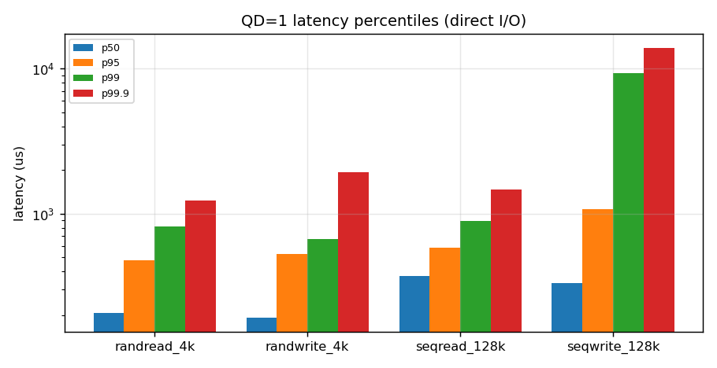
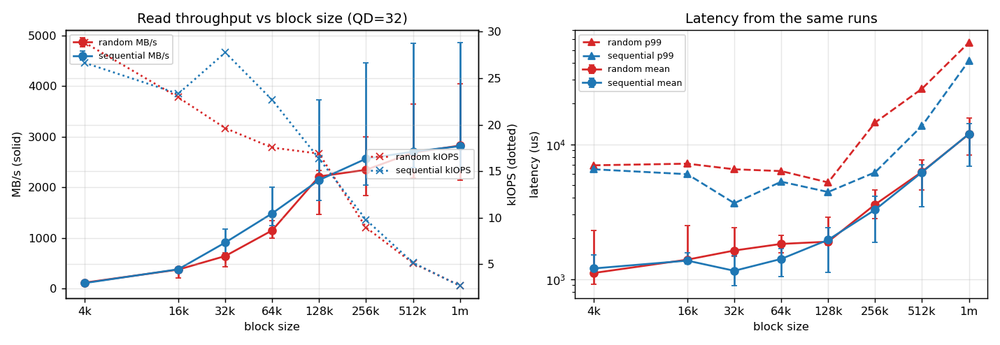
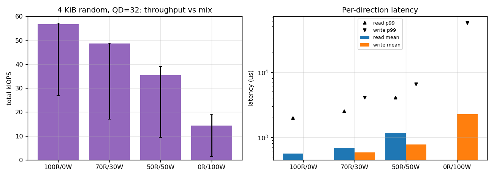
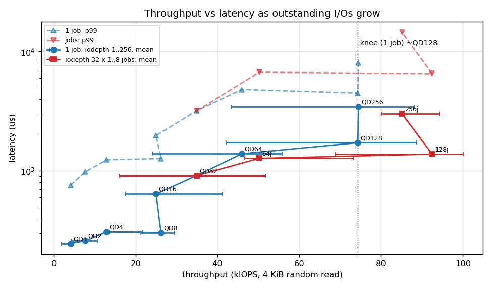
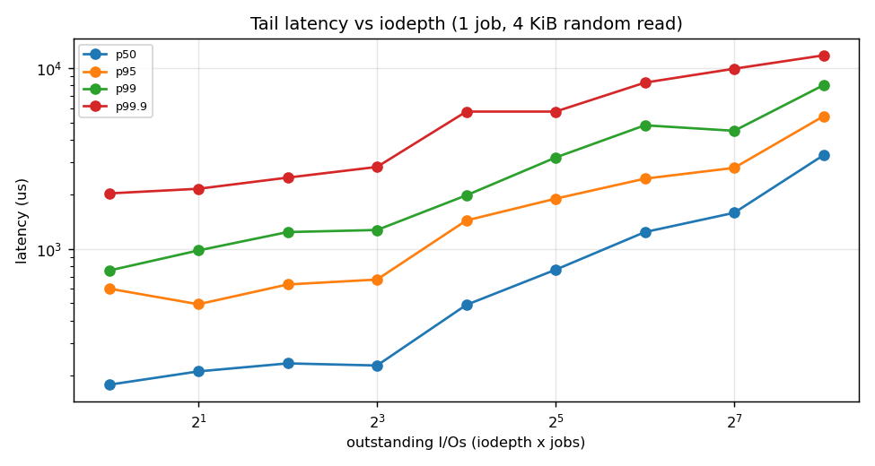
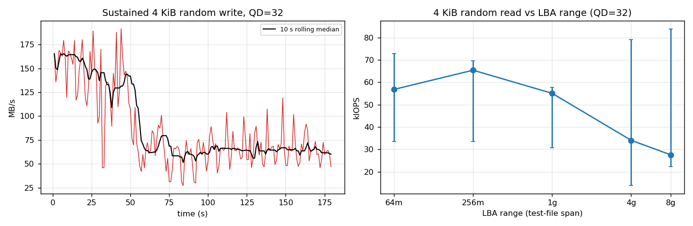
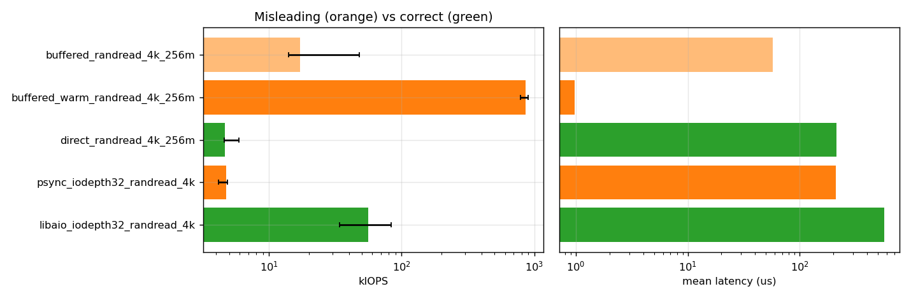

# Project 3 Report: SSD Performance Profiling

Haruto Suzuki, ECSE 4320/6320. Every number here comes from the fio JSON files in `results/raw/` (3 repeats per point unless noted). The processed tables are in `results/processed/summary.md`, and the exact job files are in `configs/`. Values are medians, with the min..max of the 3 repeats in brackets or shown as error bars. Latency means fio's total latency (submission + completion).

## 1. AI-use note

I directed this project and used Claude (Anthropic) as a coding and writing assistant. I had it generate the fio experiment runner, the job-file templates, the JSON parser and plotting script, and a first report draft, then iterated with it on the analysis.

**My work:**

- Owned the safety setup: all I/O goes to a disposable 8 GiB file on the WSL2 filesystem, never a device, never `/mnt/c` or OneDrive, and I deleted the file after each run.
- Installed fio and the Python stack, then ran the full 35-minute suite plus the 180 s sustained-write test.
- Identified the SSD (WD PC SN740 512 GB, NVMe) from Windows.
- Reran the buffered-I/O pitfall after the first version didn't show the cache effect, which produced the 863k IOPS / 1 us result.
- Reviewed the report against the rubric and my data and owned the final version.

**Changed during review (with Claude):**

- **The first buffered-I/O pitfall didn't show the page cache at all.** Buffered and direct reads came out about the same (6.1k vs 4.4k IOPS), because fio drops the file's page cache before each job by default (`invalidate=1`). The test was redesigned to warm the cache with a sequential read first and then run with `invalidate=0` (Section 9).
- **The first throughput-latency plot joined the iodepth sweep and the multi-job points into one line.** Those use different submission paths, so they were split into two curves.

**Not done.** No SMART temperature or throttling data. Reading it needs admin rights on Windows, and the WSL2 guest can't see the physical NVMe device.

## 2. Setup and methodology

| item              | value                                                                                                                                              |
| ----------------- | -------------------------------------------------------------------------------------------------------------------------------------------------- |
| SSD               | WD PC SN740 512 GB (SDDQNQD-512G-1201), NVMe, PCIe 4.0 x4 client drive                                                                             |
| path to the SSD   | fio (libaio, O_DIRECT) -> WSL2 ext4 -> Hyper-V virtual SCSI disk (VHDX) -> Windows NTFS -> NVMe driver -> SSD                                      |
| target            | one 8 GiB test file, `~/fio-test/testfile`, on the WSL2 ext4 root (`/dev/sdd`, 1 TB virtual disk). Never a raw device; the script refuses `/dev/*` |
| guest block queue | scheduler `none`, `nr_requests=950`, 4 KiB-aligned I/O (all block sizes are multiples of 4 KiB)                                                    |
| OS / tools        | Ubuntu on WSL2, kernel 6.18.54.1-microsoft-standard-WSL2; fio 3.36                                                                                 |
| CPU / memory      | Intel Core i7-1355U; 32 GB DDR5 (15 GiB visible to WSL2)                                                                                           |
| I/O settings      | `direct=1`, `ioengine=libaio`, `norandommap`, `randrepeat=0`, incompressible data (`refill_buffers`, `buffer_compress_percentage=0`)               |
| timing            | 2 s ramp (not counted) + 10 s measured per point; 3 full repeats; one 180 s sustained-write run                                                    |
| preconditioning   | one sequential 1 MiB write pass over the whole 8 GiB file before any test                                                                          |
| power             | Windows "Best performance", on AC power, apps closed                                                                                               |

**What's actually being measured.** A file inside WSL2 isn't the bare SSD. Every I/O goes through the guest kernel, the Hyper-V storage stack, and the Windows NTFS/NVMe path. So this report measures the SSD _as seen from a WSL2 VM_. Section 10 goes into how that shifts the absolute numbers. The shape of the curves (scaling, knees, tails, state effects) still comes from the SSD.

**Run-to-run variability.** Repeat 1 (14:53 to 15:03) ran 30 to 50% slower than repeats 0 and 2 in almost every experiment. For example, QD=32 random read measured 51.9k, 16.1k and 34.9k IOPS across the three repeats. It looks like something on Windows was competing for the SSD during that window. I report medians, and I only make claims where the effect is bigger than the min..max spread.

## 3. Pre-experiment hypotheses (written before running)

1. **QD=1:** 4 KiB random read around 50 to 100 us (NAND read plus controller and software stack). 4 KiB random write is faster at the median because writes land in the SLC/DRAM cache, but its p99 is worse. 128 KiB sequential is a few hundred us.
2. **Block size:** IOPS falls and MB/s rises with block size until the interface or controller limit (PCIe 4.0 x4: about 7 GB/s raw). Random and sequential converge at large blocks, since a 256 KiB+ random read already spans many flash pages and dies.
3. **Mix:** throughput drops as writes are added, and reads stuck behind program/erase operations show a higher p99.
4. **QD:** IOPS scales almost linearly up to about QD 32 to 64 (enough requests to keep all the flash dies busy), then flattens while latency keeps going up. Little's law, QD = IOPS x mean latency, should hold within a few percent since fio keeps the queue full.
5. **Tails:** p99 and p99.9 grow faster than the median past the knee, and write tails are dominated by garbage collection.
6. **Device state:** sustained random writes slow down once the SLC cache fills.
7. **Pitfall:** buffered I/O reports RAM latency instead of SSD latency, and `iodepth` does nothing with a synchronous engine.

## 4. Zero-queue (QD=1) baselines (Fig. 1)

| workload           | IOPS  | MB/s | mean   | p50 | p95   | p99   | p99.9  |
| ------------------ | ----- | ---- | ------ | --- | ----- | ----- | ------ |
| 4 KiB random read  | 3,981 | 16.3 | 248 us | 208 | 477   | 815   | 1,237  |
| 4 KiB random write | 3,859 | 15.8 | 254 us | 192 | 528   | 668   | 1,942  |
| 128 KiB seq read   | 2,559 | 335  | 387 us | 375 | 586   | 889   | 1,466  |
| 128 KiB seq write  | 1,337 | 175  | 700 us | 334 | 1,073 | 9,372 | 13,959 |

- **Latency is 2 to 4x what I expected.** A 4 KiB read takes 208 us at the median, compared with the 50 to 100 us that's typical for NVMe on bare metal. The direct-I/O control run in Section 9, on a 256 MiB range, also gives 212 us. So this is a fixed per-I/O cost of the virtualized path (guest -> VHDX -> NTFS), not the flash itself.
- **The random write median (192 us) is a bit lower than random read (208 us).** Writes get acknowledged once they reach the controller's cache, while reads have to wait for the NAND. That matches the first half of hypothesis 1.
- **Write tails are much heavier.** 128 KiB sequential write has a p99 of 9.4 ms, 28x its median, and the mean (700 us) is twice the median. A few writes get stuck behind flushes or garbage collection. Reads stay within about 4x of the median at p99.

## 5. Block-size and pattern sweep (Fig. 2)

Reads at QD=32, with throughput and latency from the same runs:

| block   | random IOPS | random MB/s | seq IOPS | seq MB/s | random mean / p99 latency |
| ------- | ----------- | ----------- | -------- | -------- | ------------------------- |
| 4 KiB   | 28.8k       | 118         | 26.7k    | 109      | 1.1 / 7.0 ms              |
| 16 KiB  | 22.9k       | 376         | 23.3k    | 382      | 1.4 / 7.2 ms              |
| 64 KiB  | 17.5k       | 1,150       | 22.7k    | 1,486    | 1.8 / 6.3 ms              |
| 128 KiB | 16.9k       | 2,214       | 16.3k    | 2,143    | 1.9 / 5.2 ms              |
| 256 KiB | 8.9k        | 2,346       | 9.8k     | 2,564    | 3.6 / 14.5 ms             |
| 1 MiB   | 2.7k        | 2,825       | 2.7k     | 2,813    | 11.9 / 56.9 ms            |

There are two regimes:

- **IOPS-bound (4 to 128 KiB).** IOPS only drops from 29k to 17k while the block size grows 32x, so MB/s rises almost in proportion to block size. The per-request cost dominates here, and in this stack a big part of that is per-I/O software overhead.
- **Bandwidth-bound (256 KiB and up).** MB/s levels off at about **2.3 to 2.8 GB/s**, and latency grows in proportion to block size since each request is now waiting on the data transfer. The best single repeat hit 4.9 GB/s (sequential 1 MiB), so the median ceiling is set by the virtualized path and host contention, not the PCIe 4.0 x4 link (about 7.9 GB/s raw).

**Random vs sequential** only really differ at 32 to 64 KiB, where sequential is 30 to 40% faster, and they converge from 128 KiB up. That matches hypothesis 2. Two things close the gap: a large random read already spans several flash pages across dies, and the SSD's read-ahead has less to add.

Little's law checks out on the latency column: at QD=32 and 28.8k IOPS, the mean latency should be 32 / 28.8k = 1.11 ms, and I measured 1.109 ms.

## 6. Read/write mix (Fig. 3)

4 KiB random, QD=32:

| mix        | total IOPS | read mean / p99 | write mean / p99   |
| ---------- | ---------- | --------------- | ------------------ |
| 100% read  | 56.7k      | 0.56 / 1.96 ms  | -                  |
| 70R / 30W  | 48.7k      | 0.69 / 2.51 ms  | 0.59 / 4.05 ms     |
| 50R / 50W  | 35.3k      | 1.17 / 4.05 ms  | 0.77 / 6.52 ms     |
| 100% write | 14.3k      | -               | 2.25 / **56.9 ms** |

- **Throughput drops as writes go up**, 4x lower from all-read to all-write, which matches hypothesis 3. A NAND program takes roughly 10x longer than a read, and while a die is programming, any read queued to that die has to wait.
- **Reads suffer from writes they didn't issue.** Read p99 doubles from 1.96 to 4.05 ms at 50/50. That's read-behind-write interference.
- **Pure random writes have huge tails.** p99 is 57 ms, 25x the mean, which fits with garbage collection pausing writes while it frees up blocks (Section 8).

One caveat: the 100% read point (56.7k IOPS) is about 2x the same configuration in the block-size sweep (28.8k). Section 10 discusses this.

## 7. Queue depth: throughput-latency knee and Little's law (Fig. 4)

4 KiB random read, one fio job, iodepth 1 to 256:

| QD                          | 1    | 2    | 4    | 8    | 16   | 32   | 64   | 128      | 256   |
| --------------------------- | ---- | ---- | ---- | ---- | ---- | ---- | ---- | -------- | ----- |
| kIOPS                       | 4.0  | 7.7  | 12.9 | 26.2 | 25.0 | 34.9 | 45.9 | **74.3** | 74.5  |
| mean latency (ms)           | 0.25 | 0.26 | 0.31 | 0.30 | 0.64 | 0.91 | 1.39 | 1.72     | 3.44  |
| Little's N = IOPS x latency | 1.0  | 2.0  | 4.0  | 8.0  | 16.0 | 31.9 | 63.9 | 127.9    | 255.9 |

- **Linear region (QD 1 to 8).** Throughput goes up 6.5x while latency only rises 23%. The SSD is handling the extra requests in parallel across its flash dies and channels.
- **Diminishing returns (QD 16 to 128).** Each doubling of QD now adds more latency than throughput. From QD 8 to 128, IOPS goes up 2.8x while latency goes up 5.7x.
- **Knee at QD ≈ 128.** Going from QD 128 to 256 adds no throughput (74.3k to 74.5k) and doubles latency (1.72 to 3.44 ms). Past that point, requests are just sitting in a queue. I predicted a knee at QD 32 to 64. The per-I/O overhead of the virtualized path pushes it later, because more requests in flight are needed to cover the longer service time.
- **Little's law holds to 3 significant figures at every point** (last row). fio runs a closed loop that keeps exactly `iodepth` requests outstanding, so N = X x R is basically guaranteed, but checking it still proves the requested queue depth was really reached. Section 9 shows a setup where it isn't.

**Parallelism instead of depth.** Spreading the I/O over several jobs (32 deep x 1, 2, 4 or 8 jobs) gets more out of the drive: **92.5k IOPS at 128 outstanding with 4 jobs**, vs 74.3k with one job at QD 128, and at lower latency (1.38 vs 1.72 ms). A single submitting thread hits its own limit, with `sys_cpu` at 58% at QD 128. 8 jobs (256 outstanding) don't beat 4 (85k vs 92k), so the system-wide knee is about **90k IOPS at around 128 outstanding I/Os**.

## 8. Tail latency and device state (Fig. 5, Fig. 6)

| 4 KiB random read       | p50      | p95   | p99    | p99.9  | p99.9 / p50 |
| ----------------------- | -------- | ----- | ------ | ------ | ----------- |
| QD 1                    | 177 us   | 602   | 758    | 2,023  | 11x         |
| QD 16 (mid)             | 490 us   | 1,434 | 1,974  | 5,734  | 12x         |
| QD 128 (knee)           | 1,581 us | 2,802 | 4,489  | 9,896  | 6x          |
| 32 x 8 jobs (past knee) | 2,212 us | 7,504 | 14,484 | 27,656 | 13x         |

- **At low and mid QD, the tail comes from device events.** The p99.9 / p50 ratio stays around 11 to 12x from QD 1 to 16. A fixed fraction of requests hits a busy die or a host hiccup regardless of load.
- **At the knee, queueing takes over.** The median itself grows (1.6 ms) because every request is waiting behind about 127 others, so the whole distribution shifts right and the ratio drops to 6x.
- **Past the knee, the tail blows up.** With 8 jobs, p99.9 is 27.7 ms and p99 is 14.5 ms. That's 3x the knee's p99 for less than 1.2x the knee's throughput. For anything latency-sensitive, running past the knee buys almost no throughput and costs a lot of tail latency.

**Burst vs steady state (180 s of sustained 4 KiB random writes, QD=32, 1 s samples).**

| window      | 0-20 s | 20-40 s | 40-60 s | 60-180 s |
| ----------- | ------ | ------- | ------- | -------- |
| median MB/s | 162    | 133     | 109     | 60 to 66 |

Write throughput holds at about 147 MB/s (median) for the first 50 s, then drops off a cliff at around 55 s and settles at about 64 MB/s for the remaining two minutes, a **2.3x** loss. Over the whole run, p99.9 write latency is 54 ms. About 7.4 GB had been written when the cliff hit.

This is the burst-to-steady-state transition from hypothesis 6. Early writes land in the SLC cache, and once that fills, the drive has to write directly to TLC while also garbage-collecting. There's a second possible explanation: 7.4 GB is close to one full overwrite of the 8 GiB test file. After that, random 4 KiB overwrites leave lots of partially valid blocks, and GC has to copy live data before it can erase anything. Both would produce this kind of sharp, permanent drop, and without SMART or controller counters I can't tell them apart.

I also can't fully rule out thermal throttling without SMART access. But the drop is too abrupt (a single step at about 55 s) and too stable afterwards to look like a thermal ramp.

**LBA range (4 KiB random read, QD=32).** IOPS is 57k to 65k for 64 MiB to 1 GiB spans, then falls to 34k at 4 GiB and 28k at 8 GiB, with median latency doubling. A likely cause is the SSD's mapping table. The SN740 is a client design that caches its logical-to-physical map in a small buffer (as far as I know it uses a host memory buffer instead of DRAM on the drive). A small LBA span keeps its map entries cached, while a wide span forces an extra flash read to fetch the mapping before the actual data read. The spread here is large (13.8k to 79k at 4 GiB), so I'd call this trend suggestive, not conclusive.

## 9. Misleading setups (Fig. 7)

**Pitfall 1: buffered I/O measures RAM, not the SSD.** 4 KiB random read, QD=1, 256 MiB range, 3 repeats:

| setup                                              | IOPS                  | mean latency | p99    |
| -------------------------------------------------- | --------------------- | ------------ | ------ |
| direct I/O (correct)                               | 4.7k [4.6k..5.9k]     | 212 us       | 578 us |
| buffered, fio default (`invalidate=1`, cold cache) | 17.2k [14.0k..47.7k]  | 58 us        | 391 us |
| buffered, cache pre-warmed, `invalidate=0`         | **863k** [783k..899k] | **1.0 us**   | 2.0 us |

With a warm cache, the buffered "SSD latency" is **1 us at 863k IOPS**. That's 212x lower latency and 185x more IOPS than the real device. It's just DRAM speed through the page cache, and the NAND is never touched.

The cold-cache case is a sneakier trap. fio drops the file's cached pages before the job starts (`invalidate=1`), so the run starts on the SSD. But every block it reads stays cached, and the 256 MiB range fits in memory, so later reads hit RAM more and more often. The result (58 us mean, with IOPS swinging between 14k and 48k across repeats) doesn't describe either the SSD or RAM, and it depends on how long the run lasted. In my first full run this case looked almost like direct I/O (6.1k IOPS), which is why I added the warm-cache version to make the effect obvious.

A benchmark that forgets `direct=1` will report something between SSD speed and DRAM speed depending on the cache state. The fix is `direct=1`, plus a sanity check that QD=1 latency is physically believable for flash (tens to hundreds of us, never about 1 us).

**Pitfall 2: the wrong effective queue depth.** `iodepth=32` with a synchronous engine (`psync`) gives **4.7k IOPS at 209 us, the same as QD=1** (4.7k at 212 us). With `libaio`, the same `iodepth=32` gives 56.1k IOPS at 569 us, 12x more. A synchronous engine blocks on every I/O, so `iodepth` gets silently ignored. Little's law catches it: N = 4.7k x 209 us = 0.99 outstanding, not 32. With libaio, N = 56.1k x 569 us = 31.9.

## 10. Anomalies and limitations

- **The virtualization layer dominates absolute latency.** QD=1 reads take about 210 us instead of the 50 to 100 us I'd expect from this drive on bare metal, and the median bandwidth ceiling (2.8 GB/s) is below the drive's rating. Running fio natively on Windows (`windowsaio`) or on bare-metal Linux would isolate the SSD better. I used a WSL2 file so the setup would be completely safe, with no raw device involved.
- **Same configuration, different answers in different experiments.** 4 KiB random read at QD=32 measured 28.8k (block-size sweep), 34.9k (QD sweep), 56.7k (mix), 56.1k (pitfall rerun) and 55.1k (1 GiB range) IOPS at the median. It's the same workload run at different times. The likely causes are host-side contention (Windows services, and the VHDX living on the system drive), background garbage collection after the write-heavy experiments, and maybe the range-dependent mapping effect from Section 8. Trends within each experiment are consistent, so I only compare _across_ experiments at the level of 2x or more.
- **Repeat 1 was disturbed** (Section 2). Taking the median of 3 limits the damage, but more repeats would tighten the error bars.
- **No SMART, temperature, or host-side device stats**, so thermal throttling can't be fully ruled out for the sustained-write test.
- **Limited preconditioning.** One sequential fill of 8 GiB isn't a full-drive steady state in the SNIA PTS sense. The sustained-write run shows the transition but doesn't establish the drive's worst-case steady state.
- **The test file shares the drive with the OS**, so I can't rule out Windows I/O to the same SSD during runs.
